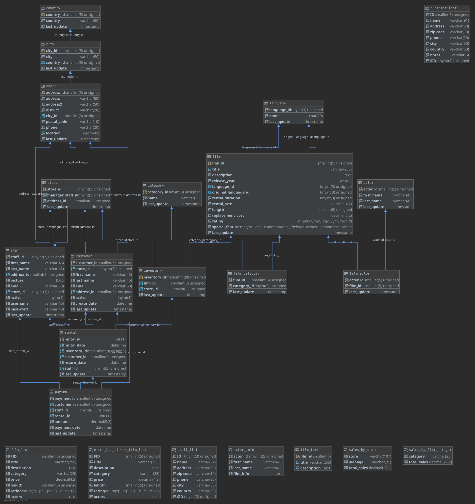

> [!WARNING]
> **This image is archived.** It is no longer built or published, and the existing tags on Docker Hub
> will not receive any updates. It was retired on 2025-12-28 because the URL started returning HTTP 403 Forbidden.
> The files are kept here for reference only and may not build anymore.

# 1maa/sakila:latest

The [Sakila sample database](https://dev.mysql.com/doc/sakila/en/sakila-introduction.html) loaded on `mysql:8.1`.


## Sample Usage

```
$ docker run -d -e MYSQL_ROOT_PASSWORD=root -p 127.0.0.1:3306:3306 --name sakila 1maa/sakila:latest
```

## Schema


